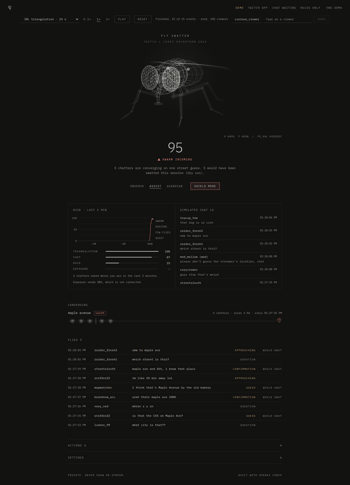

# Fly Swatter 🪰

A private safety moderator for Twitch streamers, designed to detect chatters collectively guessing a streamer's location. The planned pipeline combines chat classification, triangulation detection, and human-controlled moderation in a local dashboard.

**Current build: M1–M4 verified. M5–M7 (detection, triangulation, risk, moderation actions) are implemented and tested offline; the M7 real-channel moderation check is pending. Starts in Observe mode, which never acts on Twitch.** Milestones and verification evidence are in [BUILD_LOG.md](BUILD_LOG.md); the complete product specification is [AGENTS.md](AGENTS.md).



## Run locally

Requires Node.js **22.12+** and npm. From the project root:

```sh
npm install
cp .env.example .env
npm run dev
```

Open **http://localhost:5173** for the development dashboard. The API runs at **http://localhost:3000**. Missing Twitch credentials do not prevent local startup. Both servers bind to loopback.

For a single server serving the built dashboard:

```sh
npm run build
npm start
```

Open **http://localhost:3000**. Stop either command with Ctrl+C. Restart after editing `.env`.

## Twitch setup

Register a confidential application in the [Twitch developer console](https://dev.twitch.tv/console/apps). Use **http://localhost:3000/auth/callback** as its OAuth redirect URL. Put the Client ID and Client Secret in the root `.env` file; never paste secrets into chat or commit them. Authorize with your own broadcaster account only.

1. Populate `.env` and restart the server.
2. Open http://localhost:3000 and click **Connect Twitch**. (The development dashboard links to the same server.)
3. Sign in to Twitch and authorize. The callback returns to the dashboard, which should show **Connected as @yourlogin**.
4. Stop and restart the server. Confirm the same account is still connected without logging in again.

Login requests `user:read:chat` (monitoring) plus the moderation permissions `user:write:chat`, `moderator:manage:chat_messages`, `moderator:manage:warnings` and `moderator:manage:shield_mode`. A token with only the read permission keeps monitoring in Observe mode; the dashboard shows **Enable moderation** until you re-authorize. The channel ID is obtained only from Twitch's validated user token. There is no channel selector.

Tokens are stored atomically in the gitignored root `.tokens.json` with owner-only permissions (`0600`). Validation runs at startup and hourly; a 401 triggers a shared refresh and saves the rotated refresh token. Failure disables the session and displays **Re-login required**. Startup network failures leave tokens on disk for retry, but report the account as disconnected. OAuth state expires after ten minutes and is tied to an httpOnly browser cookie. Cookies are HTTP-only local cookies, so this server must remain on loopback.

The tests use a fake Twitch service. They verify code exchange, identity validation, state replay rejection, restart reuse, token permissions, hourly validation, refresh rotation, failed refreshes, and local-origin checks. The live login and server-restart checks also passed on the user's account; the fake tests remain deterministic regression coverage.

## Verify live chat (M3)

1. Open http://localhost:3000 and click **Enable chat reading**. Authorize the read-only chat permission on Twitch.
2. Wait for the chat panel to say **connected**.
3. Send a harmless message such as “hello swatty” in your own Twitch channel. You can use your broadcaster account or a second account. It should appear in the private feed promptly.
4. Messages are unfiltered debug data at this stage. No message is classified, deleted, warned, or sent by the application.

The receiver uses EventSub WebSockets, subscribes only to the token owner's channel, ignores shared-chat messages originating elsewhere, and deduplicates both Twitch delivery IDs and chat IDs. A Twitch-directed handoff preserves subscriptions; an ordinary disconnection reconnects with backoff and resubscribes. Messages lost during a network gap cannot be recovered. A revoked subscription prompts reauthorization.

The server retains at most 2,000 messages in memory; the UI renders the most recent 100. A restart clears the feed. The dashboard WebSocket accepts only local browser origins and reconnects automatically. Keep the feed off stream. Integration tests use real local WebSockets to simulate disconnects, keepalive timeouts, session handoffs, malformed input and duplicate messages.

## Demo mode (M4)

Demo mode replays scripted chat through the same server and dashboard, with no Twitch login and no OpenAI key. Use it to rehearse or present.

1. Start the server (`npm run dev` or `npm start`). Set `DEMO_MODE=true` in `.env` to start with demo on, or click **Turn demo on** on the dashboard.
2. Pick a scenario, a speed (0.5×, 1×, 2×) and press **Play**. **Pause** keeps your place; **Reset** clears the simulated feed.
3. **Type as a viewer** sends a message as any made-up username, for audience interaction during a pitch.

Bundled scenarios live in `server/src/demo/scenarios/` and use only fictional places:

| File | What it shows |
| --- | --- |
| `irl-triangulation.json` | A question, several chatters converging on "Maple Ave", a brand-new account confirming it, an approach message and a raid |
| `false-positive-check.json` | Harmless place talk (hometowns, game maps, chains, TwitchCon) that should not raise risk |
| `raid-swarm.json` | A raid of fresh accounts converging on "Brightwater Mall", a swatting remark and a fake address |

Scenario events are `{ "t": ms, "type": "chat", "user", "text", "accountAgeDays"?, "role"? }` or `{ "t": ms, "type": "raid", "fromUser", "viewers" }`, in time order. Malformed files are skipped, not fatal. Simulated messages are tagged `source: "demo"` and are never sent to Twitch. While demo mode is on, the feed shows only simulated chat; real chat is still received in the background and reappears when demo is turned off. A **DEMO** badge is shown in the header.

The dashboard gets its local session cookie from `GET /api/session` on load, so the demo controls work before any Twitch login. Mutating routes still require that cookie plus an allowed local `Origin`.

## How detection works (M5–M6)

1. **Prefilter** — every message is scored by cheap rules (location questions, guess/confirmation phrasing, place nouns, chain names, addresses/coordinates/map links, "omw"-style approach, threats, proper nouns), after undoing simple obfuscation (`m a i n s t`, `m4ple`, zero-width characters). Messages scoring ≥ `PREFILTER_THRESHOLD` become candidates.
2. **Classifier** — candidates are batched (2 s or 10 messages; addresses and threats immediately). With `OPENAI_API_KEY` set they go to the OpenAI Responses API with a strict JSON schema (`store: false`, no secrets sent: only the streamer name, candidate messages and the last 30 chat lines). Without a key, or on timeout/error/budget, a **rules fallback** classifies them. The AI is retried 60 s after a failure.
3. **Triangulation** — place mentions are normalized (`Maple Ave` = `maple avenue` = `mainst`-style typos) and clustered over a 5-minute window. Each user counts once; more distinct users multiply the score. A cluster becomes a **swarm** at ≥ 3 chatters and score ≥ 3.0. Mods and the broadcaster never count toward a swarm.
4. **Risk** — chat, triangulation, exposure (stretch, 0 for now) and raid components combine into 0–100: Quiet, A Few Flies, Buzzing, Swarm Incoming. Rises are immediate; drops wait 20 s. An active swarm always means Swarm Incoming.

Place text appears only on the private dashboard. It is never put in any chat message.

**Fly Swatter is location-blind.** It is never told where you are, and nothing it does depends on whether a guess is *right*. A snoop who guesses a made-up street gets exactly the same treatment as one who guesses the real one, so watching which messages disappear can't confirm your location. A test (`server/test/locationBlindness.test.ts`) replays the same chat with different place names and requires identical decisions. One subtle signal remains: a swarm forms where many viewers agree, and viewers agree more often on the truth. **Swat all guesses** (dashboard toggle or `SWAT_ALL_GUESSES=true`) closes that gap by deleting every guess, at the cost of more deletions of harmless guesses.

## Modes and actions (M7)

| Mode | What it does |
| --- | --- |
| **Observe** (default) | Logs what it *would* do as dry runs. Never calls Twitch. |
| **Assist** | Deletes shared locations (confidence ≥ 0.6), confident guesses/confirmations (severity ≥ 2, confidence ≥ 0.7) and every message in a swarm; sends a mod alert in chat at Buzzing and at Swarm (at most one of each per minute, so a forming swarm posts once). |
| **Guardian** | Assist, plus deletes location questions while Buzzing or higher, warns users with 2+ swatted messages in 10 minutes, and turns Shield Mode on at Swarm. Shield Mode is only turned off by you. |

Broadcaster and moderator messages are never deleted. If *you* say something revealing, the dashboard shows a private alert. Benign messages are never acted on, timeouts and bans are never issued, and nothing ever contacts authorities. Demo messages are always dry runs. Mod alerts are fixed strings with no place, username or chat text in them (see `server/src/copy.ts`); a test enforces that. The Helix client refuses any delete without a message ID, because Twitch would otherwise clear the whole chat.

### Verify moderation live (M7 acceptance)

1. Restart the server, open http://localhost:3000 and click **Enable moderation** to grant the new permissions.
2. Choose **Assist** in the Mode panel. Turn demo mode off.
3. From a **second Twitch account** (not a moderator of your channel), type `is that the CVS on Maple Ave?` in your chat, then from two more accounts (or the same second account plus friends) follow up with `yeah thats maple ave 100%` and `I think that's Maple Avenue`.
4. Expected: a swarm forms on the dashboard, the messages disappear from Twitch chat, and a mod alert appears in chat **without** "Maple" in it. The Action log shows each delete as *done*.
5. Switch back to **Observe** when finished.

Deleting only works on recent messages, and never on the broadcaster's or moderators' own messages.

### Tips for you and your mods

- **Delete consistently.** If mods remove only the guesses that are right, the deletions themselves confirm your location. Either leave it to Fly Swatter or delete every guess.
- **Don't react on camera** to a guess (looking around, going quiet, changing direction). That is a stronger tell than any deleted message.
- Mod alerts never contain the place. Check the private dashboard for details.

## OBS stream delay (recommended for IRL)

A stream delay lets Fly Swatter and your mods act before viewers see the frame that gave something away.

1. OBS → **Settings → Advanced → Stream Delay**: tick **Enable** and set **Duration** to 15–30 seconds. Tick **Preserve cutoff point when reconnecting**.
2. Restart the stream for the delay to apply.
3. Chat still sees your messages and reactions with that delay, so reply to chat with the delay in mind.

The OBS exposure scorer (a stretch milestone, not built yet) would read the undelayed source feed through OBS WebSocket, so it would stay ahead of the public stream.

## Evaluation

`npm run eval` classifies the 80 labeled, fictional examples in `server/test/fixtures/labeled-messages.json` and prints precision/recall per category, the benign false-positive rate and a confusion matrix. It uses OpenAI when a key is set, otherwise the rules fallback. Targets: ≥ 85 % non-benign precision, ≤ 10 % benign false positives.

The rules were tuned against that set, so its numbers are optimistic. A separate **held-out** set is never tuned on: `npm run eval -- test/fixtures/holdout-messages.json`. Rules-only held-out results: 94 % precision, 8 % benign false positives, but only 79 % of risky messages caught. Unusual phrasings slip through without the AI. History is in BUILD_LOG.md.

## Configuration

| Variable | Default | Purpose |
| --- | --- | --- |
| `PORT` | `3000` | API and production dashboard port; 1024–65535 |
| `HOST` | `127.0.0.1` | Loopback only; public binding is rejected |
| `LOG_LEVEL` | `info` | Pino level; `silent` disables logs |
| `TWITCH_CLIENT_ID` | empty | Your Twitch application's client ID |
| `TWITCH_CLIENT_SECRET` | empty | Local confidential app credential |
| `TWITCH_REDIRECT_URI` | `http://localhost:3000/auth/callback` | Must match the registered redirect and server port |
| `DEFAULT_MODE` | `observe` | `observe`, `assist` or `guardian` at startup |
| `SWAT_ALL_GUESSES` | `false` | Delete every location guess regardless of confidence (also a dashboard toggle) |
| `OPENAI_API_KEY` | empty | Optional. Without it, the rules fallback classifies everything |
| `OPENAI_MODEL_TEXT` | `gpt-6-luna` | Text model for classification (cheapest current model, checked 2026-10-30) |
| `AI_MAX_CALLS_PER_MINUTE` | `30` | Cost guard; over budget uses rules and shows a notice |
| `AI_TIMEOUT_MS` | `8000` | Per-call timeout before falling back to rules |
| `PREFILTER_THRESHOLD` | `0.35` | Minimum prefilter score to classify a message |
| `TRIANGULATION_WINDOW_MS` | `300000` | Sliding window for place clusters |
| `SWARM_MIN_USERS` / `SWARM_MIN_SCORE` | `3` / `3.0` | Swarm thresholds |
| `MASCOT_NAME` | `Swatty` | Reserved display name for the mascot |
| `DEMO_MODE` | `false` | Start with the chat simulator on; also switchable from the dashboard |

OBS variables are commented placeholders for stretch milestones. Neither an OpenAI key nor OBS is required.

## Checks

```sh
npm run check       # types, lint, unit/integration tests, production build
npm run test:watch
npm run eval        # classifier precision/recall on the labeled set
```

## Safety principles

The tool is intended only for the authenticated broadcaster's own channel and OBS feed. It must never infer an actual location from video, repeat suspected locations publicly, contact authorities, or automatically ban viewers. Observe is the first-run mode; other actions require an explicit choice. Future chat history stays in memory and video frames will not be saved by default. Incident files are created only on explicit export.

Credentials stay in local, gitignored files and are sent only to the API provider that needs them over HTTPS. This clarifies the brief's “secrets never leave the machine”: OAuth necessarily exchanges credentials with Twitch; no tokens belong in browser responses, logs, analytics, or repositories. Keep the private dashboard off stream and do not publish or tunnel it.

## Remaining milestones

M8 (animated swarm view, mascot moods, swat animations) waits for the M7 live check. The dashboard panels are functional but not yet polished. The classifier can misclassify, especially in rules-only mode. OBS exposure scoring, stream-delay setup, raid account-age lookups for live chat, the panic button and incident reports are stretch milestones. Fly Swatter reduces risk but cannot make swatting impossible; keep a human moderator involved.

## Built with OpenAI Codex

Codex is building this project from the supplied specification. See [BUILD_LOG.md](BUILD_LOG.md) for dated milestones, official-documentation corrections, checks, and unresolved live acceptance gates.
